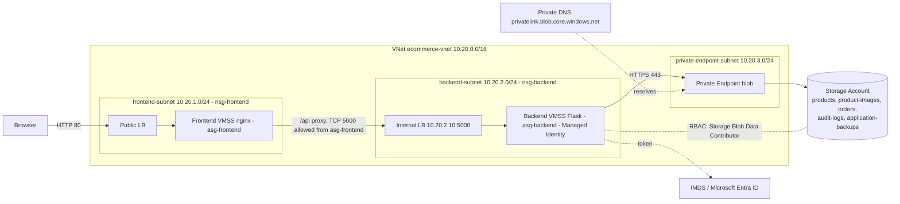

# QuickKart on Azure - Phase 2 (Seller publishing, COD orders, Queue, Tables, Delivery)

> Phase 1 (three-tier + Managed Identity + NSG/ASG + VMSS) is unchanged. Phase 2 adds login/roles, seller publishing, COD ordering, Azure Queue + Table Storage, a queue consumer, delivery workflow and dashboards. Start with `docs/ASSESSMENT.md`, then `docs/DEMO-GUIDE.md`.

Browser → **nginx VMSS** (presentation) → **Flask VMSS** (application, system-assigned Managed Identity) → **Blob Storage** via **private endpoint**. No database, no storage keys.

## Phase 2 workflow
Seller logs in -> adds product (Blob JSON + image, status Draft) -> **Publish** -> home page shows it (API returns Published only) -> customer logs in -> cart -> **COD checkout** -> order JSON (Blob) + stock decrement (ETag ledger) + TableService row + TableQueue row + message in `quickkart-order-queue` -> consumer sets **Processing** -> admin sets **Out for Delivery** -> **Delivered** (Blob + Table + audit) -> admin confirms cash (**Paid**).
| Store | Holds |
|---|---|
| Blob | products, product-images, orders (archive), audit-logs, users, carts |
| Queue | `quickkart-order-queue`, `quickkart-order-poison` |
| Table | `TableQueue`, `TableService` |
Blob, Queue and Table are separate services - **not one transaction**. Safety comes from idempotency keys, ETags, an inventory ledger, an outbox flag and `reconcile()` (see `docs/ARCHITECTURE.md`).
Roles: `seller` (own products), `customer`, `admin` (delivery operator). Demo users are created by `deploy.sh`; passwords are in `scripts/.state/credentials.env`.
Docs: `ASSESSMENT.md` `API.md` `ENVIRONMENT.md` `CHANGES.md` `DEMO-GUIDE.md` `TEST-REPORT.md` `DEPLOYMENT.md` (migration + rollback) `TROUBLESHOOTING.md`.

## Quick start
```bash
az login
cd scripts && ./deploy.sh            # ~10 min deploy + ~5 min cloud-init
./test-storage.sh accept             # 22 acceptance tests + infra checks
python3 e2e_test.py --local          # offline logic check (no Azure)
./cleanup.sh                         # stop billing
```
Override: `RG=my-rg LOCATION=southindia ./deploy.sh <subscription>`.

## Architecture


## Azure services
VNet, 3 subnets, 2 ASGs, 2 NSGs, NAT Gateway (outbound for package install), Public + Internal Standard LB, 2 VMSS (Ubuntu 22.04, B2s) with CPU autoscale 1/2/4, Storage Account (StorageV2, LRS, shared keys **disabled**, public access **disabled**), 5 containers, Private Endpoint + Private DNS zone, system-assigned Managed Identity, RBAC role assignment, Log Analytics + Blob diagnostics (Azure Monitor).

## Folder structure
```
backend/  app.py config.py worker.py routes/{auth,products,cart,orders,admin,storage}.py services/{auth,blob,queue,table,order,queue_worker,audit,identity}_service.py models/{product,order}.py
frontend/  index products cart checkout orders login seller admin storage-dashboard (.html) css/style.css js/{app,auth,shop,seller,admin,storage}.js
infrastructure/ main networking storage identity vmss monitoring (.bicep)
scripts/   env.sh deploy.sh e2e_test.py test-storage.sh configure-rbac.sh configure-vmss.sh configure-worker.sh update-app.sh cleanup.sh
tests/     fake_azure.py (offline in-memory fakes for e2e_test.py --local)
docs/      ARCHITECTURE.md DEPLOYMENT.md DEMO-GUIDE.md TROUBLESHOOTING.md
```
| File | Purpose |
|---|---|
| `blob_service.py` | All Blob CRUD; ETag `If-Match` on update/delete; `create_only` on create |
| `identity_service.py` | `DefaultAzureCredential` (Managed Identity on Azure, `az login` locally) |
| `audit_service.py` | One JSON blob per event: `audit-logs/YYYY/MM/DD/<ts>-<id>-<event>.json` |
| `deploy.sh` | Packages code into cloud-init, runs Bicep, verifies RBAC |
| `vmss.bicep` | Reusable tier: LB + VMSS + (identity) + autoscale |

## Prerequisites
Azure subscription (Contributor + **User Access Administrator/Owner** for the role assignment), Azure CLI ≥ 2.50 (`az bicep install`), bash, curl, python3.

## Authentication flow
1. Flask calls `DefaultAzureCredential` → IMDS `169.254.169.254` on the VMSS instance.
2. IMDS asks Microsoft Entra ID for an OAuth2 token (audience `https://storage.azure.com`) for the VMSS identity.
3. SDK sends `Authorization: Bearer <token>` to `https://<account>.blob.core.windows.net` (resolves to the private IP).
4. Storage validates the token and checks **RBAC** → `Storage Blob Data Contributor` allows read/write/delete.
Tokens are short-lived and auto-refreshed; nothing is stored.

## Blob layout
`products/{id}.json` · `product-images/{id}-{rand}.{jpg|png|webp}` · `orders/{ORD-id}.json` · `audit-logs/YYYY/MM/DD/*.json` · `application-backups/` (explorer demo).

## API
| Method | Endpoint | Function |
|---|---|---|
| GET | `/api/products` · `/api/products/{id}` | list / get (response includes `etag`) |
| POST | `/api/products` | create (`create_only`) |
| PUT / DELETE | `/api/products/{id}` | update / delete; send `If-Match: <etag>` → 409 on concurrent change |
| POST | `/api/products/{id}/image` | multipart `image` (JPG/PNG/WebP ≤5 MB, magic-byte checked) |
| GET / POST | `/api/orders` | history / create (decrements stock with ETag, rolls back on conflict) |
| GET | `/api/health[?deep=1]` | shallow for LB probe; deep checks token + storage |
| GET | `/api/storage/info` · `/containers` · `/containers/{c}/blobs` · `/blob/{c}/{name}` | dashboard + explorer |
| POST / DELETE | `/api/storage/upload` · `/api/storage/blob/{c}/{name}` | explorer upload / delete (`test-*` or backups only) |

## ASG / NSG
`nsg-frontend`: Allow 80/443 Internet→asg-frontend, Allow LB probe, Deny all else. `nsg-backend`: Allow TCP 5000 **only from asg-frontend** →asg-backend, Allow LB probe, SSH only from Bastion subnet `10.20.250.0/26`, Deny Internet, outbound 443 → `10.20.3.0/24`. NICs join ASGs via the VMSS network profile, so new instances are covered automatically.

## Autoscaling
Both VMSS: min 1 / default 2 / max 4; avg CPU > 70 % (5 min) → +1, < 30 % → −1, 5-min cooldown. Demo: `scripts/configure-vmss.sh load`.

## Testing
`scripts/test-storage.sh accept` (tests 1-15) · scenarios: `nsg-block|nsg-unblock|dns-break|dns-fix|public-access` · `configure-rbac.sh remove|add` · `configure-vmss.sh mi-disable|mi-enable`. See `docs/TROUBLESHOOTING.md`.

## Cleanup
`scripts/cleanup.sh` (deletes the whole resource group).

## Cost (approx., pay-as-you-go, 24×7 — destroy after class)
4 × B2s VMs (~$0.05/h each ≈ $0.20/h), 2 Standard LBs (~$0.025/h each + data), NAT Gateway (~$0.045/h + data), 3 public IPs, Private Endpoint (~$0.01/h), Log Analytics (per GB), Storage (cents). Roughly **$6–8/day** → run the demo, then `cleanup.sh`. Check current prices in the Azure calculator.

## Notes / limits
HTTP only for the demo (443 allowed in NSG; add Application Gateway/cert for TLS). Portal blob browsing is blocked by design while public access is Disabled: use the Explorer page, or temporarily `az storage account update -n <acct> -g <rg> --public-network-access Enabled --default-action Deny` + `network-rule add --ip-address <yourIP>` and grant yourself *Storage Blob Data Reader*. Code was syntax-checked locally; run `deploy.sh` + `test-storage.sh accept` in your subscription to validate end-to-end.
